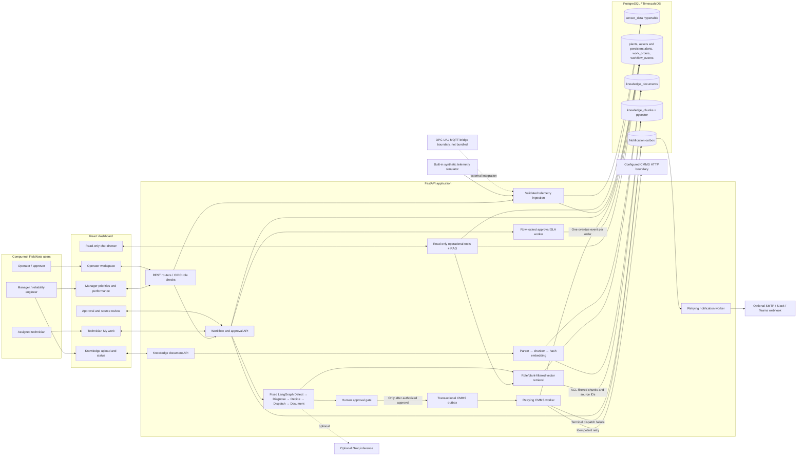
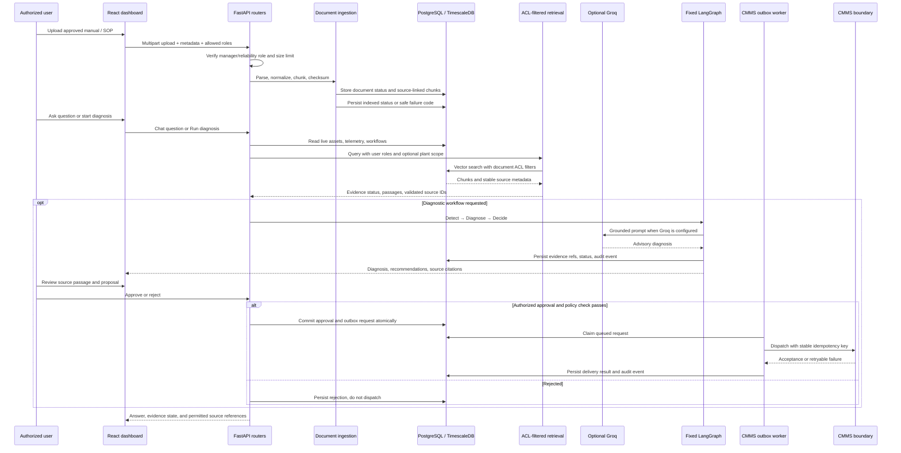

# Compunnel FieldNote

A maintenance decision-support reference platform for monitoring equipment, retaining condition alerts, and turning operator investigations into diagnosed, policy-checked, human-approved maintenance work. Compunnel FieldNote includes an async FastAPI backend, a fixed LangGraph workflow, PostgreSQL with TimescaleDB and pgvector, and a React dashboard with Operator, Manager metrics, My work, and Knowledge views.

> **Operating boundary:** This is a reference application, not a certified industrial control system. It does not control machinery. The included telemetry source, CMMS behavior, and local retrieval embeddings are demonstration implementations; validate and replace them before operational use.

Repository: [SP-Shailendra/agentic_predictive_maintenance](https://github.com/SP-Shailendra/agentic_predictive_maintenance).

## Contents

- [Architecture](#architecture)
- [Current feature inventory](#current-feature-inventory)
- [Using the dashboard](#using-the-dashboard)
- [Repository map](#repository-map)
- [Workflow and persistence](#workflow-and-persistence)
- [Run with Docker](#run-with-docker)
- [Configuration](#configuration)
- [API reference](#api-reference)
- [Operations and troubleshooting](#operations-and-troubleshooting)
- [Security and production readiness](#security-and-production-readiness)
- [Known boundaries](#known-boundaries)

## Architecture

The system separates device-side collection, plant-side orchestration, and enterprise-facing maintenance records. The React UI polls the API for current assets, telemetry, workflow activity, and approval decisions.



### Layers and responsibilities

| Layer | Responsibilities | Implementation in this repository |
| --- | --- | --- |
| Edge | Read equipment signals and forward events | `backend/agents/edge_simulator.py`; HTTP ingest contract is the adapter boundary for OPC UA and MQTT Sparkplug B |
| Plant / gateway | Validate telemetry, persist time-series data, run agent workflow, expose APIs | FastAPI routers, SQLAlchemy async sessions, TimescaleDB hypertable, LangGraph workflow |
| Cloud / enterprise | Retrieve maintenance context, infer diagnoses, create enterprise work orders, support operator review | pgvector-backed knowledge table, optional Groq inference, CMMS service, React dashboard and approval controls |

### Runtime data flow



The API validates telemetry and persists it before any workflow starts. Diagnosis is an explicit operator action, not a simulator side effect. Knowledge upload is synchronous in the current implementation: the API extracts text, chunks it, assigns the demo hash vector, and stores document/chunk state before returning. RAG filters indexed chunks by allowed roles and optional plant query scope; plant scope is not an identity entitlement. Workflow citations are server-built from retrieved chunk IDs and stored without copying source passage text into audit events. Only an authorized approval reaches the transactional CMMS outbox; the separate SLA and notification workers use row locks/leases for multi-worker safety.

**Current RAG implementation boundary:** `knowledge_chunks.embedding` is `vector(384)`, but vectors are deterministic token hashes, not semantic embeddings. Search is vector-distance only; hybrid keyword search, reranking, OCR, original-file storage, and claim-level citation entailment are not implemented. The retrieval evaluation fixture provides a baseline, not a quality certification.

## Repository map

```text
agentic_predictive_maintenance/       # Clone directory; an existing local checkout may use another name
├── .env.example
├── .gitattributes                  # Keep PDF/DOCX fixtures binary
├── .gitignore                      # Exclude credentials, local data, and generated files
├── README.md
├── RAG_Implementation_Roadmap_Predictive_Maintenance.md
├── docker-compose.yml
├── backend/
│   ├── Dockerfile
│   ├── requirements.txt
│   ├── main.py
│   ├── alembic.ini
│   ├── alembic/
│   │   ├── env.py
│   │   ├── script.py.mako
│   │   └── versions/               # Versioned database migrations
│   ├── core/                       # Settings, database, migrations, OIDC roles, audit helpers
│   ├── models/                     # Plants, assets/alerts, telemetry, workflows, outboxes, documents
│   ├── schemas/                    # Asset, chat, knowledge, simulator, workflow contracts
│   ├── agents/                     # Simulator, diagnosis, policy checks, fixed LangGraph
│   ├── services/                   # Alert lifecycle, ingestion, RAG, chat, delivery/SLA workers
│   ├── routers/                    # assets, plants, telemetry, workflow, simulator, chat, knowledge
│   ├── scripts/evaluate_rag.py      # Disposable-database retrieval evaluation
│   └── tests/
│       ├── fixtures/rag_retrieval_eval.json
│       ├── test_industrial_readiness.py
│       ├── test_rag_ingestion.py
│       └── test_workflow_postgres_integration.py
├── frontend/
│   ├── Dockerfile
│   ├── package.json
│   ├── tailwind.config.js
│   ├── postcss.config.js
│   ├── vite.config.js
│   ├── index.html
│   └── src/
│       ├── App.jsx                 # Role views, scope-safe polling, alerts, workflow actions
│       ├── main.jsx
│       ├── index.css
│       ├── dashboard.css           # Dashboard layout, responsive views, alert/approval styling
│       ├── components/             # Navbar, assets, signals, reviews, Knowledge, chat, My work
│       └── services/
│           ├── auth.js             # OIDC Authorization Code + PKCE browser session
│           └── api.js              # REST client, bearer tokens, multipart document upload
├── samples/knowledge_documents/    # Eight synthetic fixtures: two PDF/DOCX/TXT/MD each
└── scripts/
    ├── backup.ps1
    ├── restore.ps1
    └── verify-backup.ps1
```

**Backend ownership:** `core/` owns settings, database setup, identity, and audit helpers; `models/` owns persistence; `schemas/` owns API contracts; `agents/` owns fixed workflow orchestration; `services/` owns domain logic and integrations; `routers/` owns HTTP behavior. `services/telemetry_ingest.py` owns the shared live-condition and persistent-alert transitions used by simulator, scenario, and HTTP ingestion paths. `main.py` applies migrations, initializes demo records, and starts the enabled background workers.

**Frontend ownership:** `App.jsx` composes the four role-based views, plant selection, refresh lifecycle, acknowledgement actions, and work-order navigation. Components own individual tools and panels; `services/api.js` owns HTTP requests and `services/auth.js` owns browser identity. The interface displays the product name **Compunnel FieldNote**.

**Local-only files:** `.env`, `.data/postgres/`, backup archives, private keys, virtual environments, `node_modules/`, caches, and build output are ignored by Git. Create `.env` from the placeholder-only `.env.example`; never commit real credentials. The committed PDF/DOCX samples are marked binary in `.gitattributes` to prevent line-ending conversion.

## Current feature inventory

### Operator dashboard

- **Responsive workspace:** A two-column desktop canvas keeps the asset list beside selected-asset detail. Tablet/mobile layouts reflow without a nested approval-queue scroll area. A compact status strip shows assets needing attention, pending approvals, and an estimate of stale telemetry assets in the selected plant scope. Connection status remains independent of the refresh spinner.
- **Selected-asset views:** Signals, Workflows, History, Limits, and Demo tools tabs separate telemetry, investigations, the asset event timeline, threshold controls, and simulator scenarios. The selected header includes diagnosis and contextual chat actions, telemetry freshness, and the reading window.
- **Plant and asset scope:** Switch between the portfolio and individual plants. Search assets by tag/name/location; filter by condition and criticality; sort by condition (attention first, then criticality/ID), criticality, vibration, temperature, or ID.
- **Persistent condition alerts:** Live Normal/Attention condition follows the latest reading, while a threshold breach opens a persisted alert. The attention count and open-alert filter retain the asset until an operator/reliability engineer acknowledges the alert and three consecutive newer normal readings confirm recovery. A breach resets recovery progress; gaps over 60 seconds restart it, and duplicate/older readings cannot advance it. Acknowledgement after confirmed recovery clears the alert only when the last reading is no more than 60 seconds old. Alert clearance does not complete maintenance work.
- **Attention versus agent runs:** Simulator/telemetry ingestion updates live condition and persistent alerts, but never starts a workflow automatically. **Run diagnosis** explicitly starts the Detect → Diagnose → Decide → Dispatch → Document graph; the navbar bell is for pending approvals. Acknowledging a condition alert does not approve or dispatch a work order.
- **Asset health:** Compact rows show asset ID, a criticality icon with tooltip, equipment name, latest vibration/temperature, and visible Normal/Attention condition labels. Limit percentages can exceed 100%; only the visual proximity bar is capped. Tooltips distinguish demo advisory limits from asset-specific limits. The 7.1 mm/s and 85 °C defaults are demonstration values, not certified operating envelopes.
- **Telemetry:** Vibration and temperature plots appear by default; **Show all signals** adds pressure and RPM. Aligned plots use signal-specific axis precision, padded domains, a shared hover point, latest/hovered reading bar, units/source, hover min/max, workflow markers, and a 30/60/120/500-reading range. The chart cursor appears only while hovering. Freshness is a cadence estimate; range checks are payload validation, not calibration.
- **Synthetic-data visibility:** When the simulator is enabled, the navigation shows **SYNTHETIC DATA** with source and demo-limit details. A selected asset whose latest displayed reading uses `edge-simulator` shows a **Synthetic reading** label. The Signals readout includes the actual source; scenario readings use `scenario:<name>`. These labels distinguish generated data from external telemetry, not certify measurement quality.
- **Work orders and approvals:** The approval bell and status-strip action open a drawer grouping pending orders by asset and overdue priority, with overdue groups first and oldest requests first within priority. Rows show waiting age, date, status, and review action; overdue approvals are marked in both the drawer and bell. Recently decided work follows. The Workflows tab shows asset-specific investigations. SIM-prefixed references are labelled simulated.
- **Decision context and trace:** The review modal separates Decision and Trace tabs, keeping the persisted graph/audit trace out of the initial decision view. It includes diagnosis age, current asset status, and latest vibration/temperature deltas. Stale proposals remain approvable only after a separate explicit acknowledgement, recorded in the audit event. Trace entries are not a continuously running monitor; workflow IDs can be copied. Chat sources can select an asset or open a work order.
- **RAG evidence and citations:** Diagnostic retrieval records evidence status (`available`, `no_matches`, or `unavailable`) separately from the answer. Retrieved chunk/document IDs, revision, page, and section are persisted in workflow state and assessment audit details; citation IDs are validated against retrieved chunks. Reviewers can expand a reference to fetch its exact passage through a role/plant-checked endpoint. Retrieval errors are logged without query or document text and counted in Prometheus as `rag_retrieval_requests_total` by outcome.
- **Duplicate-investigation protection:** The dashboard disables Run diagnosis and links to the existing investigation while it is processing, awaiting approval, queued/retrying/dispatching, dispatched, or in progress. The API enforces the same rule under an asset row lock and returns HTTP 409 with the existing work-order ID. Rejected, completed, and closed work does not block a new investigation.
- **Deep links:** `#asset/{asset_id}` and `#workflow/{id}` routes select the requested record after reload and participate in browser history. Chat source actions, approvals, workflow rows, and timeline events navigate to these routes.
- **Technician work:** The dedicated **My work** view shows active/completed work assigned to the verified technician subject. Managers/reliability engineers can assign active work orders by directory subject; changes are audited. Lifecycle updates and fixed-taxonomy close-out remain role-gated by the API.
- **Asset history:** The History tab combines threshold edits, workflow audit events, simulator scenario events, and condition transitions derived from stored readings. Derived historical transitions are labelled as estimates because older condition transitions were not separately persisted.
- **Manager view:** A page-header switch replaces the operator workspace with an overdue-first approval queue showing asset, criticality, waiting age, and direct review actions, followed by useful-alert rate, top-three root-cause accuracy, approval-to-CMMS-acceptance p95, and lifecycle counts. KPIs refresh with dashboard polling and manual Refresh, show their own update timestamp/loading/error state, and never display another plant's KPI results while switching scope. Performance and lifecycle counts are all-time, non-simulated orders; the approval queue explicitly includes demo orders. Empty metrics use neutral **Not measured** states with missing-data context; measured results below five samples are preliminary. Targets come from the metrics API. Scenario-marked and historical `SIM-` orders are excluded from real performance samples; the simulated dispatch count is shown separately. These are pilot metrics derived from recorded technician close-outs and CMMS responses, not model-validation results.
- **Knowledge library:** Managers and reliability engineers can switch to **Knowledge** to upload supported maintenance documents, set metadata and allowed roles, review ingestion status/failure codes, and expand indexed records to inspect extracted source passages page-by-page/in chunks. The document list follows the selected plant scope.
- **Per-asset thresholds:** Reliability engineers/managers can set or clear vibration and temperature overrides with a required reason and review change history. Clearing a field uses the configured demo default.
- **OIDC browser login:** Public provider authority/client/redirect settings enable Authorization Code + PKCE; access tokens are attached to API calls. Role-aware controls mirror API roles. With settings absent, local mode is explicitly unverified. No OIDC client secret belongs in frontend build variables.

### Workflow, security, and operations

- **Sequential decision-support graph:** Detect classifies the supplied operator alert; Diagnose uses retrieved notes and optional Groq or a threshold fallback; Decide runs demo policy checks; Dispatch waits for approval; Document stores a summary and trace. These are fixed LangGraph nodes, not independent agents or continuous anomaly detection.
- **Human authorization:** Operator/reliability-engineer workflow creation, approver-only approve/reject, verified-creator self-approval prevention, locked decision rows, technician/operator/reliability lifecycle updates, manager/reliability assignment, technician close-out, and manager-only KPI access are enforced by the API. Browser role controls are presentation only; API authorization is authoritative.
- **Audit and delivery:** Workflow events carry actor/role attribution in a per-work-order SHA-256 chain with database mutation-blocking triggers. Approval and CMMS outbox enqueue commit together; the worker leases with `SKIP LOCKED`, retries bounded failures, and uses an idempotency key. A separate row-locked SLA worker records one overdue event per approval. Optional SMTP and incoming-webhook notifications use a deduplicated retry outbox and contain only asset tag, status, and a deep link. This is tamper-evident, not protection against a database superuser.
- **Telemetry contract:** Single and 1–500 item batch ingest reject unknown/non-finite/out-of-range fields, timezone-naive/far-future timestamps, and duplicate source IDs. Older backfills are stored without overwriting current asset status.
- **Service operations:** `/health`, `/ready`, and protected Prometheus `/metrics`; CORS, API-key compatibility for service clients, OIDC/JWKS roles, per-process API/chat rate limits, non-root backend container, mounted secret-file support, Alembic migrations, telemetry retention opt-in, and PowerShell backup/restore/restore-verification scripts.
- **External boundaries:** OPC UA/MQTT Sparkplug B and historian clients are not included. The generic CMMS HTTP boundary requires vendor validation; simulator scenarios are always routed to simulated references. No machinery control or safety interlock path exists.

### Simulator scenarios

The scenario controls in the selected asset's **Demo tools** tab appear only when `/health` reports `simulator_enabled=true`. Operators/reliability engineers can run `vibration_rise`, `overheating`, `sudden_spike`, `data_dropout`, `invalid_reading`, `sensor_flatline`, or `healthy_baseline`, with 1–120 readings, 0–1 severity, and an optional force-threshold-fallback flag. The panel provides scenario selection, severity/duration controls, start/stop actions, and permission/error feedback. Scenario data is tagged `scenario:<name>` and passes the same validated ingest/status-update helper as single telemetry ingestion. Invalid values are rejected and audited, dropout writes no reading, and reset stops the scenario and adds a healthy-baseline sample.

Scenarios are for demonstrations and tests only. They do not automatically run the workflow. An operator still clicks **Run diagnosis**. Workflows started during an active/recent scenario carry a `simulated_only` marker, so approval cannot send them to a configured real CMMS. Production configuration rejects an enabled simulator.

### Live-data assistant

The navigation chat drawer uses optional plant/asset context and returns answer timestamps, source references, a rule-based badge when Groq is not used, and `knowledge_status` (`not_searched`, `available`, `no_matches`, or `unavailable`). It has nine read-only tools: list plants/assets, read an asset, summarize up to 500 telemetry rows (including a true last-hour window), list workflows, read workflow events/detail, retrieve maintenance notes, and estimate data freshness. Tool calls are capped at four, output and history are bounded, requests are rate-limited, and chat is not written to work-order audits. It cannot start/approve/reject/dispatch workflows, change thresholds, or control scenarios. Without Groq or if the model fails, common questions use deterministic live database queries; unsupported measures such as RUL or calibrated fault probability are declined.

The drawer includes loading/error states, retry, navigable sources, focus trapping, and a mobile sheet layout. **Ask about this asset** opens it with selected-asset context. Its diagnosis shortcut uses the dashboard's explicit investigation action, not a chat write tool, and does not bypass workflow authorization or human approval.

### Knowledge document ingestion

Managers and reliability engineers can ingest PDF, DOCX, TXT, and Markdown maintenance documents from the dashboard's **Knowledge** view or through `POST /api/knowledge/documents`. The UI supports metadata, role selection, status/failure review, and retry by re-upload. Text is extracted, normalized, split into overlapping word chunks, and stored with document/chunk IDs, filename, type, page or section when available, manufacturer, asset type, revision, optional source URI, plant scope, and allowed Compunnel FieldNote roles. SHA-256 checksums reject already-indexed duplicates. The document list and RAG retrieval apply the stored role/plant scope. Uploads are limited by `KNOWLEDGE_MAX_UPLOAD_MB` (10 MB by default). Retrieval exposes separate `no_matches` and `unavailable` outcomes.

Eight synthetic upload fixtures are provided in `samples/knowledge_documents/`: two each of PDF, DOCX, TXT, and Markdown. Every file is labeled as a test sample, not a site-approved procedure.

Ingestion stores extracted chunks and metadata, not the original uploaded binary. Failed rows expose a safe failure code, not parser internals or document text. Chat knowledge-source IDs and diagnostic references use stored chunk IDs; diagnostic review can open an ACL-checked source passage. Original-binary retention, OCR, embedding upgrades, hybrid search, and reranking remain future work.

## Using the dashboard

| View | Main tasks | API-authorized roles |
| --- | --- | --- |
| Operator | Inspect assets/Signals, acknowledge condition alerts, start investigations | Operator/reliability engineer for acknowledgement and diagnosis; approver for decisions |
| Manager metrics | Review overdue-first approvals and non-simulated performance | Manager; approval decisions still require approver role |
| My work / Technician assignments | Review assigned orders, assignment, lifecycle, close-out | Technician for assigned work/close-out; manager/reliability engineer for assignment |
| Knowledge | Upload references, inspect ingestion status and indexed passages | Manager/reliability engineer for upload and dashboard view; stored role ACLs apply to retrieval |

In local development without OIDC, role controls use an explicitly unverified demo identity. Production API roles remain authoritative.

1. Select a plant or keep **All plants**, then search/filter Asset Health and select an asset. Normal/Attention describes the latest live condition; **Alert open** is a separate persisted state.
2. Inspect **Signals** for current values, source, freshness, and trends. Choose the reading window or **Show all signals** for pressure and RPM. The **SYNTHETIC DATA** badge describes simulator configuration, not a separate data page. `edge-simulator` identifies generated readings; `scenario:<name>` identifies demo scenario readings.
3. Open **Attention: Open alerts** to keep unresolved condition alerts visible even when the latest readings return to Normal. Use **Acknowledge alert** in the selected asset header. The alert clears only after acknowledgement and three consecutive newer normal readings; a new breach or gap over 60 seconds resets recovery. This does not approve or complete maintenance work.
4. Optionally use **Demo tools** to start a bounded scenario. A scenario never starts an investigation automatically. Use **Limits** to review or, with the appropriate role, change advisory thresholds with a reason.
5. Choose **Run diagnosis** to create an investigation. Review it under **Workflows** or through the approvals drawer. An already-open investigation prevents a duplicate start. Check diagnosis age, current readings, evidence passages, and **Trace** before an authorized approver accepts or rejects the proposal.
6. In **Manager metrics**, review the overdue-first **Approval priorities** queue using direct **Review** actions. Performance and lifecycle counts cover all-time, non-simulated work; the approval queue includes demo orders. Refresh and six-second polling update KPIs with their own timestamp and stale/error state. Empty performance samples remain **Not measured**, not zero.
7. In **Knowledge**, upload one of the sample files from `samples/knowledge_documents/`, set metadata and allowed roles, then expand **Preview indexed passages** after successful indexing. Inspect extracted text, page/section metadata, and additional passage pages before relying on a reference.
8. Use **My work** for assigned orders and **History** for workflow, threshold, scenario, and estimated condition events. The assistant answers read-only questions about current data. Asset/work-order selections use reloadable `#asset/{id}` and `#workflow/{id}` links. Workflow approval queues asynchronous CMMS delivery; technicians record close-out separately.

## Workflow and persistence

The graph in `backend/agents/workflow_graph.py` executes these nodes in order:

1. **Detect:** Records the alert classification and a demo confidence value.
2. **Diagnose:** Retrieves related maintenance notes, then asks Groq when configured. If no Groq key exists, threshold-based advisory logic supplies a conservative fallback.
3. **Decide:** Runs the compliance checks and marks the work order as requiring human approval.
4. **Dispatch:** Holds the order until approved. After approval, it commits a CMMS outbox request in the same database transaction. A separate worker calls the configured CMMS boundary (or creates a simulated reference when no CMMS URL is configured) and retries transient failures.
5. **Document:** Adds a summary and retains the workflow activity trace on the work order.

The simulator does not start this graph when a threshold is crossed. A demo scenario writes clearly tagged, validated telemetry and the operator still clicks **Run diagnosis**. Scenario-linked approvals use a simulated CMMS reference even if a real CMMS URL is configured. `POST /api/chat` is a separate read-only interface over current database records and retrieved notes; it has no workflow or configuration write tools.

Approval and rejection are separate API operations. OIDC bearer claims determine operator, reliability engineer, approver, manager, and technician roles. A verified requester cannot approve their own work order, and decision routes lock the row to serialize competing approvers. Workflow state is stored in the `work_orders.workflow_state` JSON column; pending decisions do not depend on an in-memory LangGraph checkpoint. Rejection records a decision and never dispatches. Dispatch is asynchronous through an outbox; exactly-once delivery still depends on the CMMS honoring its idempotency key. The workflow is maintenance decision support only; it does not issue machine-control instructions.

### Data stores

- `plants`: facility code, name, location, and region used to scope dashboard data.
- `assets`: equipment metadata, owning plant, current operational/attention status, persisted alert/acknowledgement/recovery state, and optional per-asset advisory limits.
- `asset_threshold_changes`: old/new limits, verified subject when available, reason, and timestamp.
- `sensor_data`: timestamped vibration, temperature, pressure, RPM, source, and optional source event ID. TimescaleDB hypertable supports deduplicated ingest/backfill.
- `work_orders`: workflow status, diagnosis, recommendation, creator/decision subjects, lifecycle timestamps, close-out feedback, CMMS reference, and persisted graph state.
- `workflow_events`: append-only per-work-order events with actor/role metadata and a SHA-256 previous-hash chain; database triggers reject update/delete/truncate.
- `cmms_outbox`: durable transactional dispatch requests, stable work-order idempotency key, attempt/lease state, safe failure code, and CMMS reference.
- `simulator_scenarios`: one active demo scenario per asset, bounded sample count, severity, optional forced fallback, actor, and recent simulated-only dispatch window.
- `simulator_scenario_events`: start/stop/completion/rejected-sample events with actor type, subject, roles, verification flag, and scenario details.
- `notification_outbox`: deduplicated approval/dispatch notifications, channel, retry/lease state, and delivery outcome.
- `knowledge_documents`: uploaded document identity, SHA-256 checksum, descriptive metadata, plant scope, allowed roles, ingestion status, safe failure code, and chunk count.
- `knowledge_chunks`: legacy seeded maintenance notes plus ingested passages, a `vector(384)` embedding, JSON metadata, and nullable `document_id`, `chunk_index`, and `page_number` provenance. Startup seeds sample notes only when the table is empty; legacy chunks remain unlinked and readable.

The local embedding implementation is deterministic token hashing for a runnable demo; it is not a semantic embedding model. The baseline evaluation fixture is `backend/tests/fixtures/rag_retrieval_eval.json`; with a disposable database containing the seeded notes, measure Recall@K and MRR using `RAG_EVAL_DATABASE_URL=<disposable test/eval database URL> python -m scripts.evaluate_rag --k 5` from `backend/`. The runner refuses database names without `test` or `eval`. Replace the hash vectors with a validated embedding provider and re-index before treating rankings as meaningful. Schema changes are versioned with Alembic. A complete legacy schema is stamped at the initial baseline before newer migrations; a partially initialized legacy schema stops startup for manual review.

## Run with Docker

Only Docker Engine and the Docker Compose plugin are needed on the host. Images install their runtime dependencies inside Docker; no host Python or Node.js setup is required.

1. Clone the repository and create the local environment file:

	 ```powershell
	 git clone https://github.com/SP-Shailendra/agentic_predictive_maintenance.git
	 Set-Location agentic_predictive_maintenance
	 Copy-Item .env.example .env
	 ```

	 For an existing checkout, run these setup commands from the directory containing `docker-compose.yml`; cloning again is unnecessary. Start Docker Desktop on Windows and confirm its Linux engine is running before starting the stack.

2. Edit `.env`: at minimum, replace `POSTGRES_PASSWORD` and keep the password in `DATABASE_URL` in sync. Add a Groq key to enable LLM inference; it can remain empty to use the local fallback.
3. Build and start the stack:

	 ```powershell
	 docker compose up --build -d
	 ```

4. Check service status and startup logs:

	 ```powershell
	 docker compose ps
	 docker compose logs -f backend
	 ```

5. Open the dashboard at <http://localhost:4173>, API documentation at <http://localhost:8000/docs>, liveness at <http://localhost:8000/health>, and database readiness at <http://localhost:8000/ready>.

The backend waits for the database health check, runs Alembic migrations, initializes demo knowledge rows, seeds four plants and eight demo assets, then starts the optional telemetry simulator plus CMMS outbox, approval SLA, and notification workers. The current migration head is `20261014_0010`, which adds persisted condition-alert state and acknowledgement/recovery fields. Existing databases are stamped at the legacy baseline only when the expected legacy tables are present; partially initialized schemas stop startup for manual review. The backend runs as non-root and is healthy only when its database readiness query succeeds. Compose ports bind to loopback by default; PostgreSQL stays on the Compose network. The database image is `timescale/timescaledb:latest-pg16`.

Stop containers while retaining database data:

```powershell
docker compose down
```

Database files persist under the ignored `.data/postgres` directory across `docker compose down` and subsequent starts. Back up this directory before deleting it for a full database reset; `docker compose down -v` does not remove bind-mounted database files.

Create a custom-format backup and test its restore in a temporary database:

```powershell
.\scripts\backup.ps1
.\scripts\verify-backup.ps1
```

Restore an archive only into an empty database. The restore command prompts because it is destructive to the target database:

```powershell
.\scripts\restore.ps1 -BackupFile .\.backups\fieldnote-YYYYMMDD-HHMMSS.dump -DatabaseName maintenance
```

## Configuration

Values are loaded by Pydantic Settings from environment variables and `.env`. The Compose file supplies the container-to-container database URL; host-side API clients use `localhost` ports.

| Variable | Default | Description |
| --- | --- | --- |
| `POSTGRES_DB` | `maintenance` | Database name for the Compose database container |
| `POSTGRES_USER` | `maintenance` | Database user for the Compose database container |
| `POSTGRES_PASSWORD` | `change-me` | Database password; replace before use beyond a disposable demo |
| `DATABASE_URL` | Compose: `postgresql+asyncpg://maintenance:change-me@db:5432/maintenance` | Async SQLAlchemy connection string. Compose uses hostname `db`; local backend processes use `localhost` instead. |
| `GROQ_API_KEY` | Empty | Optional Groq credential. If absent, the diagnostic fallback is used. |
| `GROQ_MODEL` | `openai/gpt-oss-120b` | Groq chat-completion model identifier; set this to a model enabled for your Groq account |
| `API_KEY` | Empty | When set, requires the `X-API-Key` header for `/api/*` routes. Health endpoints remain public. |
| `OIDC_ISSUER` | Empty | HTTPS issuer expected in verified bearer-token `iss` claims; required in production. |
| `OIDC_AUDIENCE` | Empty | API audience expected in verified bearer-token `aud` claims; required in production. |
| `OIDC_JWKS_URL` | Empty | HTTPS JSON Web Key Set URL used to verify token signatures; required in production. |
| `OIDC_ROLES_CLAIM` | `roles` | Dot-separated token claim path for recognized roles: `operator`, `reliability_engineer`, `approver`, `manager`, `technician`. |
| `METRICS_API_KEY` | Empty | Required for `/metrics` outside development; send it as `X-Metrics-API-Key`. |
| `CMMS_API_URL` | Empty | Optional HTTPS endpoint receiving an approved work-order JSON payload |
| `CMMS_API_TOKEN` | Empty | Optional bearer token for the configured CMMS; required in production |
| `CORS_ORIGINS` | `http://localhost:5173,http://localhost:4173` | Comma-separated allowed browser origins |
| `SIMULATOR_ENABLED` | `true` | Start or disable the periodic telemetry simulator |
| `SIMULATOR_INTERVAL_SECONDS` | `5` | Simulator polling interval; values below one second are clamped to one second |
| `RATE_LIMIT_REQUESTS_PER_MINUTE` | `120` | In-process per-client rate limit for non-health HTTP routes. Use gateway limits for multi-worker/production deployments. |
| `TELEMETRY_RETENTION_DAYS` | `0` | Opt-in TimescaleDB retention period. `0` disables automatic telemetry deletion; audit events are not automatically deleted. |
| `DEFAULT_VIBRATION_THRESHOLD_MM_S` | `7.1` | Fallback demo advisory threshold when an asset has no override. |
| `DEFAULT_TEMPERATURE_THRESHOLD_C` | `85` | Fallback demo advisory threshold when an asset has no override. |
| `KNOWLEDGE_MAX_UPLOAD_MB` | `10` | Maximum size for one knowledge-document upload; configured range is 1–100 MB. |
| `APPROVAL_STALE_AFTER_MINUTES` | `60` | Marks an approval stale after this diagnosis age; asset-normalization and changed telemetry can also mark it stale. Acknowledgement is still required only for the stale reasons returned by the API. |
| `APPROVAL_SLA_MINUTES` | `60` | Age at which an awaiting approval is flagged overdue and audited. |
| `FRONTEND_BASE_URL` | `http://localhost:4173` | Base URL used to form asset/work-order links in notifications. |
| `NOTIFICATION_EMAIL_TO` | Empty | Optional notification recipient; email activates only when this, `SMTP_HOST`, and `SMTP_FROM` are configured. |
| `SMTP_HOST` | Empty | Optional SMTP server; email is disabled by default. |
| `SMTP_PORT` | `587` | SMTP server port. |
| `SMTP_FROM` | Empty | Sender address required to enable email notifications. |
| `SMTP_USERNAME` | Empty | Optional SMTP authentication username; password is read from `SMTP_PASSWORD` or the mounted secret file. |
| `SMTP_PASSWORD` | Empty | Optional SMTP password; mount as a secret in deployments. |
| `SMTP_STARTTLS` | `true` | Use STARTTLS for SMTP delivery. |
| `NOTIFICATION_WEBHOOK_URL` | Empty | Optional HTTPS incoming webhook for Slack/Teams-compatible notification delivery; disabled by default. |
| `NOTIFICATION_WEBHOOK_FORMAT` | `slack` | Incoming webhook payload format: `slack` text or `teams` MessageCard. |
| `VITE_API_URL` | `http://localhost:8000/api` | Frontend build-time API base URL; Compose sets this for the default local deployment |
| `VITE_OIDC_AUTHORITY` | Empty | Public OIDC authority URL; when set with a client ID, enables browser Authorization Code + PKCE sign-in |
| `VITE_OIDC_CLIENT_ID` | Empty | Public browser client ID; never place a client secret in Vite variables |
| `VITE_OIDC_REDIRECT_URI` | `http://localhost:4173/` | Registered browser sign-in and sign-out redirect URI |
| `VITE_OIDC_ROLES_CLAIM` | `roles` | Dot-separated claim path used to show role-appropriate browser controls |

API routes accept a verified OIDC bearer token with subject and recognized role claims. The static `API_KEY` remains a service-client compatibility path and does not identify a person. The frontend does not embed service keys. Production startup requires OIDC issuer/audience/JWKS, HTTPS origins and CMMS URL, a CMMS token, a metrics key, simulator disabled, and a non-default database password. Secrets can be mounted as files under `/run/secrets` in the backend container (file names use the setting name, for example `oidc_issuer` or `cmms_api_token`); connect this to the deployment platform's secret store. Local development without OIDC uses an explicitly unverified local identity and must not be deployed as production authentication.

The dashboard selector switches between the all-plants portfolio and an individual plant. Asset search, condition, and criticality filters apply within the selected scope; KPIs and pending approvals are scoped to the same plant. When both public `VITE_OIDC_AUTHORITY` and `VITE_OIDC_CLIENT_ID` are set, the browser uses OIDC Authorization Code + PKCE and sends access tokens as bearer credentials. With either value unset, local development keeps the explicitly unverified demo identity. Provider-specific client registration, redirect allowlists, role claims, and API issuer/audience/JWKS settings must agree.

## API reference

Interactive OpenAPI docs are available at <http://localhost:8000/docs> when the stack is running. Most `/api/*` endpoints accept JSON; document upload uses `multipart/form-data`. If `API_KEY` is configured, send `X-API-Key` on these endpoints.

### Assets

| Method and path | Purpose |
| --- | --- |
| `GET /api/plants` | List plants with asset, attention, and pending-approval counts |
| `GET /api/assets` | List portfolio assets with latest vibration, temperature, and plant identity |
| `GET /api/assets?plant_id={plant_id}` | Filter assets to a plant |
| `GET /api/assets/{asset_id}` | Read one asset, its plant, and latest readings |
| `POST /api/assets/{asset_id}/alert/acknowledge` | Operator/reliability engineer acknowledges an open condition alert; clears only after fresh confirmed recovery, otherwise remains open |
| `PATCH /api/assets/{asset_id}/thresholds` | Reliability engineer/manager updates per-asset advisory limits with a required reason |
| `GET /api/assets/{asset_id}/threshold-history` | Read the asset's threshold change history |
| `GET /api/assets/{asset_id}/history` | Read workflow, threshold, scenario, and telemetry-derived condition history |

### Knowledge documents

| Method and path | Purpose |
| --- | --- |
| `POST /api/knowledge/documents` | Manager/reliability engineer uploads PDF, DOCX, TXT, or Markdown as `multipart/form-data`; accepts document type, manufacturer, asset type, revision, optional source URI/plant ID, and repeated `allowed_roles` fields |
| `GET /api/knowledge/documents?plant_id={plant_id}` | List document metadata visible to the caller's roles; a plant filter includes shared and matching-plant documents |
| `GET /api/knowledge/documents/{document_id}?plant_id={plant_id}` | Read one visible document's ingestion status and metadata; plant-scoped documents require matching plant context; inaccessible documents return 404 |
| `GET /api/knowledge/documents/{document_id}/chunks?plant_id={plant_id}&limit=10&offset=0` | Read a paginated preview of indexed passages for an authorized document |
| `GET /api/knowledge/chunks/{chunk_id}?plant_id={plant_id}` | Read one cited passage with document/revision/page/section metadata after role and plant-scope checks |

If `allowed_roles` is omitted, the upload is visible to all current Compunnel FieldNote read roles. Retrieval applies the document role filter and, when provided, plant filter in SQL before returning chunks to chat or diagnosis. An unscoped portfolio query can retrieve all role-authorized plant documents; a plant-scoped query can retrieve only shared or matching-plant documents. **Plant scope is a query filter, not a per-user entitlement:** OIDC currently has no configured plant-membership claim/mapping, so do not rely on it to isolate confidential plants. Re-uploading identical bytes for an indexed/processing document returns 409; a failed checksum may be re-uploaded to retry.

### Telemetry

| Method and path | Purpose |
| --- | --- |
| `GET /api/telemetry/latest` | Return up to 60 most recent readings across assets |
| `GET /api/telemetry/{asset_id}?limit=60` | Return readings for an asset in timestamp order; `limit` is 1–500 |
| `POST /api/telemetry/ingest` | Validate and store one reading; accepts optional `source_event_id` for idempotency and updates current asset status only for the newest reading |
| `POST /api/telemetry/ingest/batch` | Validate and ingest 1–500 readings; duplicate source event IDs are skipped and reported |

Example telemetry request:

```json
{
	"asset_id": "00000000-0000-0000-0000-000000000001",
	"timestamp": "2026-10-05T12:00:00Z",
	"vibration_mm_s": 7.8,
	"temperature_c": 82.5,
	"pressure_bar": 3.4,
	"rpm": 1460,
	"source": "external"
}
```

The `asset_id` must identify a registered asset. Numeric validation bounds are vibration `0..500 mm/s`, temperature `-50..500 °C`, pressure `0..2000 bar`, and RPM `0..100000`; non-finite values, unknown fields, timezone-naive timestamps, and timestamps over five minutes in the future are rejected. The timestamp is optional and defaults to UTC now. `source` defaults to `external`. Optional `source_event_id` is unique per asset/timestamp and can be used by bridges for retry deduplication. This is a normalized ingestion boundary, not an included OPC UA or MQTT/Sparkplug B client; protocol-specific commissioning and tag mapping remain site-specific.

### Simulation scenarios

| Method and path | Purpose |
| --- | --- |
| `GET /api/simulator/scenarios` | List active demo scenarios per asset. Returns 403 when `SIMULATOR_ENABLED=false`. |
| `POST /api/simulator/scenarios` | Start a bounded scenario with asset ID, scenario name, 1–120 sample duration, 0–1 severity, and optional demo-only forced LLM fallback. |
| `DELETE /api/simulator/scenarios/{asset_id}` | Stop a scenario and ingest a healthy-baseline sample for that asset. |

Scenario samples use `source=scenario:<name>` and pass the same measurement validation and status-update helper as normal single-reading ingestion. `data_dropout` intentionally omits samples; `invalid_reading` is rejected by the existing bounds validator and is recorded as a rejection event, not stored as telemetry. Start/stop/rejection/completion events carry actor metadata in `simulator_scenario_events`. Scenarios never start a workflow. The operator must still choose **Run diagnosis**, and an order created on an asset with an active or recent scenario is marked `simulated_only`; the outbox returns a `SIM-...` reference without posting to a configured CMMS. Production settings already reject an enabled simulator.

### Live-data chat

`POST /api/chat` accepts a message up to 1,000 characters, optional plant/asset context, and up to 10 bounded turns of history. It has nine read-only tools, a maximum of four tool calls, capped tool output, and a per-client rate limit of 20 requests/minute. It cannot start workflows, approve/reject, dispatch, edit thresholds, or change scenarios; it does not write conversations to workflow audits. With no Groq key or a provider error, deterministic responses use the same live database data and set `used_llm=false`. Answers include typed source references and an `answered_at` timestamp. Unsupported values such as RUL or calibrated fault probability are explicitly declined. Chat text is advisory and is not an audit record or a maintenance decision.

### Workflows and human approval

| Method and path | Purpose |
| --- | --- |
| `GET /api/workflows` | List the latest 100 work orders |
| `GET /api/workflows?plant_id={plant_id}` | List work orders associated with one plant |
| `GET /api/workflows/{work_order_id}` | Read a work order with diagnosis age, current asset status, reading deltas, and stale reasons |
| `GET /api/workflows/my-work` | Technician-only list of work orders assigned to the verified subject |
| `POST /api/workflows` | Start a diagnostic workflow for an existing asset |
| `POST /api/workflows/{work_order_id}/approve` | Approver accepts an awaiting proposal; verified creator self-approval is rejected. CMMS delivery is enqueued transactionally. |
| `POST /api/workflows/{work_order_id}/reject` | Approver rejects an awaiting work order and records the decision without dispatch |
| `GET /api/workflows/{work_order_id}/events` | Read persisted workflow state-change events |
| `POST /api/workflows/{work_order_id}/lifecycle` | Technician/operator/reliability engineer advances `dispatched -> in_progress -> completed` |
| `POST /api/workflows/{work_order_id}/close-out` | Technician records a fixed-taxonomy root cause and whether the alert was useful; closes a completed work order |
| `PATCH /api/workflows/{work_order_id}/assignment` | Manager/reliability engineer assigns an active work order to a technician subject; the assignment is audited |
| `GET /api/workflows/metrics/maintenance` | Manager-only aggregate pilot metrics, optionally scoped by `plant_id` |

Example workflow request:

```json
{
	"asset_id": "00000000-0000-0000-0000-000000000001",
	"alert_type": "High vibration",
	"severity": "high",
	"message": "Vibration exceeded the advisory threshold during operation.",
	"telemetry": {
		"vibration_mm_s": 7.8,
		"temperature_c": 82.5,
		"pressure_bar": 3.4,
		"rpm": 1460
	}
}
```

Severity must be `low`, `medium`, `high`, or `critical`. A successful initial run normally returns `status: "awaiting_approval"`, along with diagnosis, recommendation, retrieved reference notes, diagnostic method/model identifier, and `workflow_state.activity`. Confidence is advisory and not calibrated. Verified OIDC subjects and roles are stored on workflow events; development/service identities are explicitly marked unverified. Events are append-only at the database trigger level and hash-linked per work order; this is tamper-evident within the database, not protection against a database superuser rewriting the entire chain.

```json
{ "comment": "Approved for inspection on the next maintenance window." }
```

Approval requests may add `"acknowledge_stale": true`. The API returns HTTP 409 with `requires_acknowledgement` when the diagnosis is older than `APPROVAL_STALE_AFTER_MINUTES`, the asset returned from attention to operational, or stored vibration/temperature differs from the diagnosis snapshot. Approval is not automatically denied: the approver must recheck current conditions, acknowledge in the review modal, and the decision audit event stores that acknowledgement and stale reasons. `GET /api/workflows/{work_order_id}` returns `diagnosis_age_seconds`, `current_asset_status`, `telemetry_delta`, `approval_is_stale`, and `approval_stale_reasons`.

`GET /api/workflows/my-work` is limited to the verified technician subject and returns assigned work. A manager or reliability engineer can assign an active order with `PATCH /api/workflows/{work_order_id}/assignment` and `{"assigned_to_sub":"<directory subject>"}`. Asset history is a merged view of persisted workflow/threshold/scenario records and condition transitions estimated from stored readings; it does not claim that the estimate is an exact historical status audit.

`APPROVAL_SLA_MINUTES` flags an awaiting work order overdue without changing its approval status. A row-locked background job records `approval_overdue` once and updates the existing in-app bell/drawer. SMTP and incoming webhook channels are disabled unless configured. External messages contain only asset tag, status, and a `#workflow/{id}` link. Database uniqueness and stable event keys prevent duplicate queue entries; Slack/Teams/SMTP do not all expose idempotency APIs, so a remote endpoint that accepts a message but loses its response can still cause a duplicate on retry.

Statuses include `processing`, `awaiting_approval`, `blocked`, `dispatch_queued`, `dispatching`, `dispatch_retry`, `dispatch_failed`, `dispatched`, `rejected`, `in_progress`, `completed`, and `closed`. The worker claims outbox entries using row locks/`SKIP LOCKED`, retries with bounded exponential backoff, and sends the stable work-order ID as an idempotency key. End-to-end exactly-once delivery still depends on the target CMMS honoring that key. With no `CMMS_API_URL`, the worker returns a `SIM-...` reference. The CMMS response `id` or `work_order_id` is the acceptance timestamp used for the approval-to-dispatch metric; vendor status synchronization is not implemented.

Manager metrics are computed from persisted close-outs and dispatch timestamps:

- Useful-alert rate: `alert_was_useful = true` divided by answered close-outs (target 70%+).
- Top-3 cause accuracy: confirmed root cause appears in the stored diagnosis failure-mode list (target 80%+). No prediction sample is included if the stored diagnosis has no cause list.
- Approval-to-dispatch p95: elapsed seconds from approver action to CMMS acceptance (target under five minutes).

Scenario-marked orders and historical `SIM-` references are excluded from the usefulness, root-cause, real-dispatch samples, and lifecycle counts. Responses include `usefulness_sample_count`, `root_cause_sample_count`, `dispatch_sample_count`, and `simulated_dispatch_count`; measured results with one to four samples are preliminary. Empty denominators return `null`/"Not measured" with neutral missing-data context rather than a misleading zero. The dashboard uses the API's targets and a separate KPI update timestamp. Reporting-period selectors and trend charts are not implemented; aggregates are all-time within the selected plant scope. These pilot measures are not yet validated on historical labeled site data.

`PATCH /api/assets/{asset_id}/thresholds` requires vibration/temperature values (either can be `null` to use the demo default) and a reason. Each change records previous/new limits and the verified actor subject. `GET /api/assets/{asset_id}/threshold-history` returns recent changes. Thresholds are advisory and are not engineering-approved operating envelopes unless separately commissioned by the site.

## Operations and troubleshooting

- **Docker daemon unavailable:** on Windows, start Docker Desktop and confirm the Linux engine is running. A missing `dockerDesktopLinuxEngine` pipe means Docker is unavailable; it is not a frontend or API-code failure. Run `docker compose up -d` once the engine is ready.
- **Database never becomes healthy:** inspect `docker compose logs db` and confirm the Docker host has resources and access to `.data/postgres`. The default Compose configuration does not publish PostgreSQL port `5432` to the host.
- **Backend cannot connect to PostgreSQL:** inside Compose, `DATABASE_URL` must use host `db`, not `localhost`. Ensure the database user, password, and name match the Compose settings.
- **Extension or hypertable startup error:** use the documented TimescaleDB image and check the database logs. Startup needs permission to create the `vector` and `timescaledb` extensions.
- **Browser reports API offline or CORS errors:** confirm the backend is healthy on port `8000`, `VITE_API_URL` points to a URL reachable from the browser, and that origin is listed in `CORS_ORIGINS`. Vite API URL is baked into the frontend at image build time, so rebuild after changing it.
- **API returns 429:** the API has a per-process, per-client request limit (`RATE_LIMIT_REQUESTS_PER_MINUTE`, default 120). Several dashboard tabs can exhaust it because each polls multiple endpoints. Close extra tabs and retry after the limit window, or configure an appropriate development limit. Chat has an additional separate limit.
- **Diagnosis uses a fallback:** confirm `GROQ_API_KEY` is present in `.env`, then recreate the backend container with `docker compose up --build -d backend`. Groq availability is not required for app startup.
- **Demo values look artificial:** the simulator intentionally generates synthetic signals every few seconds. Disable it with `SIMULATOR_ENABLED=false` when using an external ingestion adapter.
- **SYNTHETIC DATA is enabled but its readings are unclear:** this badge describes simulator configuration, not a separate dataset or a guarantee of fresh samples. Select an asset and inspect its vibration/temperature values and the Signals source readout. `edge-simulator` identifies default generated readings, while `scenario:<name>` identifies scenario samples. If values are absent or stale, check backend logs and `/health`, confirm the simulator is enabled, and check whether a dropout scenario is active. Real plant readings require an external ingestion adapter.
- **UI still shows an older label or layout:** rebuild/redeploy with `docker compose up --build -d frontend`, then reload the browser. Frontend source and Vite settings are bundled into the image, not applied live to an already-loaded page.
- **Normal asset still needs attention:** this is intentional when its condition alert is open. Check acknowledgement and recovery progress in the selected header. Normal readings alone do not clear an unacknowledged alert, and acknowledgement alone does not confirm recovery.
- **Manager metrics show Not measured:** the relevant real close-out/dispatch denominator is empty. Simulated orders are excluded from performance; do not interpret demo dispatches as validated results. An overdue approval remains actionable in the priority queue even when performance metrics have no samples.
- **Investigation start returns 409:** an investigation is already processing or awaiting approval for this asset. Open the existing work order instead of starting another.
- **Need to inspect container output:** use `docker compose logs -f backend`, `docker compose logs -f frontend`, or `docker compose logs -f db`.
- **Metrics:** scrape `http://localhost:8000/metrics` with `X-Metrics-API-Key` when configured. Production startup requires this key; restrict the endpoint at the network boundary as well.
- **Backups:** use `scripts/backup.ps1`, `scripts/restore.ps1`, and `scripts/verify-backup.ps1`. Restore requires an empty target database and uses TimescaleDB's pre/post-restore functions. Schedule these through your deployment platform and store the archive in off-host encrypted storage.
- **Tests:** from `backend/`, run `python -m unittest discover -s tests -p test_industrial_readiness.py -v` and `python -m unittest discover -s tests -p test_rag_ingestion.py -v`. PostgreSQL integration tests require `TEST_DATABASE_URL` to point to a disposable TimescaleDB/PostgreSQL database; they cover persistent-alert acknowledgement/recovery and role checks, approval races/self-approval, outbox retries, close-out metrics, thresholds, telemetry deduplication/chronological batches, simulator gating/source/audit/CMMS bypass, knowledge ingestion/ACL/retry, citation persistence/source access, and the RAG Recall@K/MRR fixture. Never point it at the live database.

## Security and production readiness

Before using this design in a real plant or enterprise environment:

- Configure the browser OIDC authority, public client ID, redirect URI, and provider role-claim mapping alongside the API issuer, audience, JWKS endpoint, and API role claim. The browser uses Authorization Code + PKCE and does not contain a client secret; test login, logout, token expiry, and provider claim mappings with the actual identity provider before production use.
- Do not expose shared secrets to the frontend. Protect and rotate Groq, database, metrics, and CMMS credentials; mount secret files from a deployment secret manager at `/run/secrets`.
- Keep real `.env` variants, private keys, local databases, and backup archives out of Git. `.env.example` contains placeholders only. Ignoring a path does not remove credentials already committed; rotate exposed values and handle repository-history cleanup separately if a leak occurs.
- Use least-privilege database/service accounts, off-host encrypted backups, tested restores, telemetry retention, and resource limits. Alembic migrations are now the schema authority; complete legacy schemas are stamped at the baseline, while partial schemas stop startup for manual handling.
- Add centralized structured logs, distributed traces, alerting, and gateway rate limits. The in-process IP limiter and Prometheus counters/histograms are single-instance foundations, not distributed abuse protection or full observability.
- Define role assignment, approval policy, separation of duties, site-specific safety procedures, and an external archive/verification process for audit hashes before enabling dispatch.
- Validate CMMS authentication, payload/response contracts, idempotency support for the `Idempotency-Key` header, and status reconciliation against the target system.
- Validate sensor calibration, per-asset advisory thresholds, model output, retrieved documents, and failure modes with site engineering and safety teams.
- Deploy protocol adapters in the correct network zones and test OPC UA certificates, MQTT broker authentication, Sparkplug B topic/payload handling, and reconnect behavior against the actual devices.

## Known boundaries

- OPC UA and MQTT Sparkplug B are stated integration boundaries only; no protocol client, store-and-forward bridge, historian adapter, or vendor certificates are bundled. `source_event_id` enables deduplication at the normalized HTTP ingest boundary.
- The CMMS outbox worker posts to `CMMS_API_URL` and expects a JSON response with `id` or `work_order_id`; bearer auth, retries, and an idempotency header are implemented, but vendor-specific contracts/status synchronization still require validation.
- pgvector storage is initialized and seeded, but the bundled hash vectorizer is only a lightweight demo representation, not semantic-quality RAG.
- Document ingestion now supports text extraction and provenance metadata, but does not retain original binaries, OCR scanned PDFs, or reliably infer page numbers from DOCX. Chunking is heading/page-aware but uses word-count windows; the embedding remains hash-based. Citation references are validated against retrieved chunk IDs and can open the stored passage, but claim-level citation entailment is not implemented.
- Retrieval ranking is still based on deterministic hash vectors; the baseline evaluation fixture measures Recall@K/MRR but does not certify relevance. There is no hybrid keyword/vector search or reranker yet.
- Knowledge retrieval enforces document role ACLs and optional plant query scope, but plant scope is not authorization until identity-to-plant entitlements are configured. Role ACLs are a single allowed-role list, not group, user, or document-owner policies.
- Groq diagnosis is optional and advisory. The no-key path uses simple vibration/temperature thresholds, not a trained predictive-maintenance model.
- Simulator and thresholds are for demonstration. There are no certification claims, functional safety claims, or direct machinery control paths.
- Persistent threshold condition alerts and operator acknowledgement are implemented. Alert snooze, automatic investigation creation, email/Teams delivery deduplication beyond the destination's idempotency support, reporting-period filters, weekly pilot trend reporting, and a labeled-data evaluation harness are not implemented. SLA notifications are approval-focused; they do not provide technician scheduling or escalation policies.
- Off-host audit hash verification, OPC UA/MQTT clients, historian connectors, a trained healthy-baseline detector, autonomous diagnosis/dispatch, semantic embeddings, claim-level citation entailment, drift monitoring, OpenTelemetry traces, PDF audit packs, and vendor CMMS adapters/status sync are not included. Browser OIDC is implemented but still requires provider-specific configuration and deployment validation. Metrics, role enforcement, migrations, and hash-linked events are foundations, not certification or full production observability.
